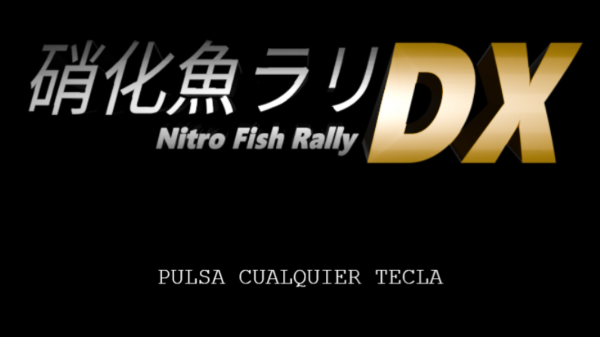

# 🐟 NITRO FISH RALLY `DX` 🐉
### *Derrapa por Japón. Acumula Aura. Conviértete en un dragón.*

Desarrollado por **LUHPEN Games**

[**📖 Diseño (GDD)**](GDD.md) &nbsp;•&nbsp; [**🎨 Assets**](assets/)

> **Nitro Fish Rally Deluxe** es un juego de carreras arcade protagonizado por el pez **alfredo-chan** a través de Japón en su viaje para ascender a dragón.

## ⭐ Características principales
* 🏎️ **Acelera a fondo:** Derrapa en cada curva para rascar el mejor tiempo en tres desafiantes circuitos a lo largo de todo Japón.
  
.png)

* ✨ **Acumula Aura:** ¡Cuidado! No solo es suficiente con completar el circuito. Acumula aura superando los obstáculos con destreza y sin chocarte para avanzar en la increíble historia de alfredo-chan.
  
.png)

* 🔧 **Personaliza:** Encuentra la armonía modificando las distintas piezas de alfredo-chan hasta encontrar la combinación perfecta de aceleración, control y freno.
  
.png)

* 🐉 **Asciende:** Convierte a alfredo-chan en un dragón milenario como dictan los pergaminos de la profecía.
  

## 🎮 Controles
* **Acelerar:** <kbd>W</kbd> | **Frenar:** <kbd>S</kbd> | **Girar:** <kbd>A</kbd> / <kbd>D</kbd> 

## 💻 Ejecución
* **Ejecutar local:** Clona el repositorio , y ejecuta mediante un servidor local.

## 🎓 Sobre el proyecto
Proyecto académico para la asignatura de **Programación de Videojuegos en Lenguajes Interpretados** por **LUHPEN Games**.

YouTube: https://www.youtube.com/@LUHPENG
Twitter: https://x.com/LUHPENG\_NFRDX
Web: https://github.com/ensatrus/NitroFishRally
